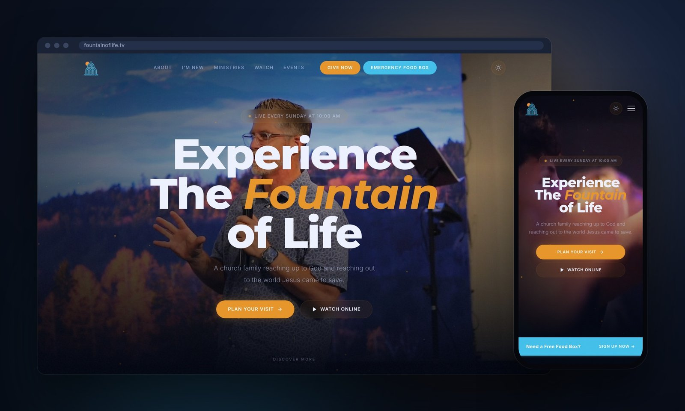
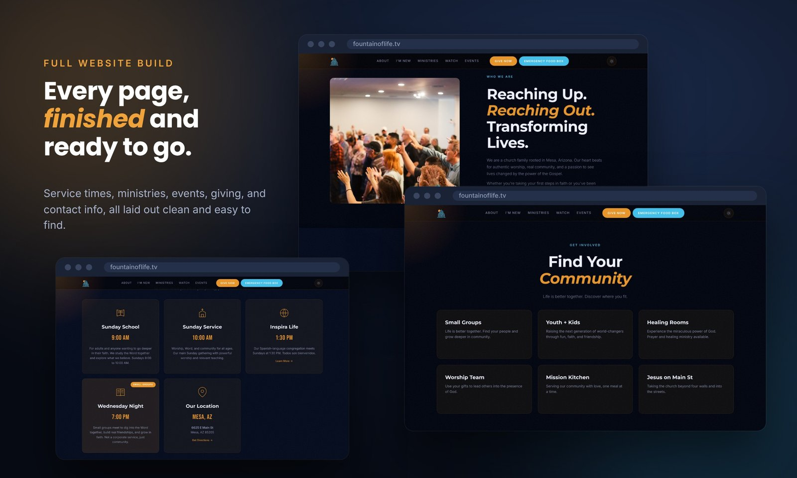
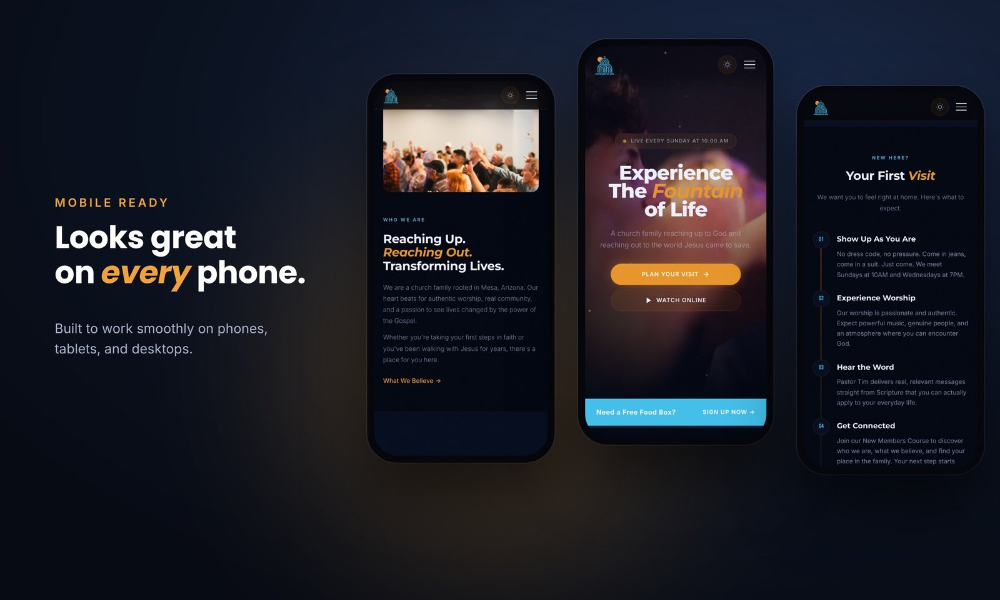

# Noah Thompson | Web & IT Portfolio

I build clean, fast websites and handle IT for small businesses, churches, and nonprofits. I also work in cybersecurity, so the sites I build are secure from the start.

**Live portfolio:** open `index.html`, or visit the GitHub Pages link once it's enabled.
**Hire me:** [Fiverr / goodgroundtech](https://www.fiverr.com/goodgroundtech)

---

## Featured Work

### Fountain of Life Christian Fellowship
**Live site:** [fountainoflife.tv](https://fountainoflife.tv)
**Type:** Church website, full build
**Stack:** HTML, CSS, vanilla JavaScript, Netlify, Netlify Functions

A complete website for a church in Mesa, Arizona. The goal was a site that feels as welcoming as walking through the front doors: easy for first-time visitors to plan a visit, and easy for members to find service times, ministries, and ways to get involved.

**Highlights**
- Hand-coded from scratch with no page builder, so it loads fast and has nothing extra to maintain
- Background video on the homepage with clear "Plan Your Visit" and "Watch Online" buttons
- Light and dark mode that follows the visitor's device setting and remembers their choice
- Sections fade in smoothly as you scroll
- Newsletter signup that runs through a serverless function on Netlify
- Built for phones first, so it looks right on any screen size
- Service times, ministries, giving, FAQ, and contact info all on clearly organized pages

[Read the full case study →](fountain-of-life.md)

| | |
|---|---|
|  |  |

---

## Services

- **Website builds and redesigns** for small businesses, churches, and nonprofits
- **Finishing and fixing existing sites** on Pixieset, Squarespace, Wix, and WordPress
- **IT and security help:** email setup, account security, and Microsoft 365 / Google Workspace

## Background

- CompTIA Security+
- B.S. in Cybersecurity and M.S. in Artificial Intelligence (in progress)
- Technical Lead at Fountain of Life Christian Fellowship since 2019 (IT infrastructure, AV and livestream production, security hardening)

---

*More projects coming soon.*
